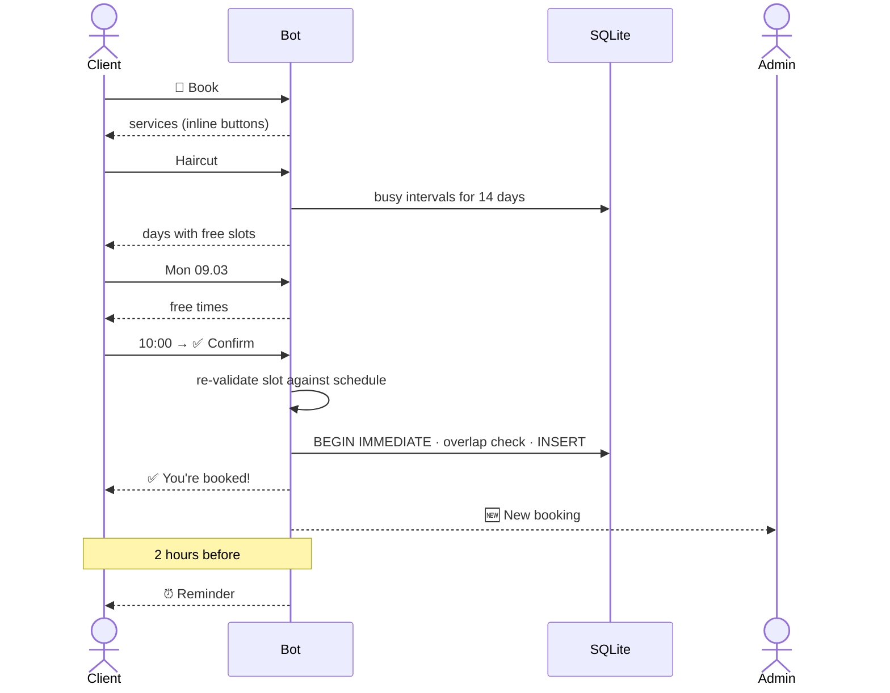

# Telegram Booking Bot

[](https://github.com/SergeyZheskiy/telegram-booking-bot/actions/workflows/ci.yml)


**Appointment booking for small businesses, in Telegram.** Barbershops, beauty salons, tutors, repair shops: clients pick a service, a day and a free time slot in a few taps; staff get notified instantly and see their agenda with one command. No website, no app to install.

Configured with a single TOML file — services, prices, working hours, breaks, time zone, language (English / Russian). Runs anywhere with Docker.

## What it does

**For clients**
- 📅 Book: service → day → time → confirm, all with inline buttons
- Only genuinely free slots are offered: working hours, lunch breaks, service duration, minimum lead time and other bookings are all taken into account
- 🗂 My bookings: list upcoming appointments, cancel with one tap
- ⏰ Automatic reminder before the appointment (skipped if they booked at short notice)

**For staff** (Telegram user ids in `ADMIN_IDS`)
- Instant notification of every new booking and cancellation, with a link to the client's chat
- `/today`, `/tomorrow`, `/week` — agenda grouped by day
- `/export` — all bookings as a CSV that opens correctly in Excel
- `/cancel 42` — cancel a booking; the client is notified

## Conversation flow



## Quick start

1. Create a bot with [@BotFather](https://t.me/BotFather) and copy the token.
2. Find your Telegram user id (e.g. via [@userinfobot](https://t.me/userinfobot)) — that's the admin id.
3. Configure and run:

```bash
cp .env.example .env                 # BOT_TOKEN, ADMIN_IDS
cp config.example.toml config.toml   # your services, hours, time zone, language
docker compose up -d --build
```

Without Docker:

```bash
python -m venv .venv && source .venv/bin/activate
pip install -e ".[dev]"
export $(grep -v '^#' .env | xargs)
python -m booking_bot
```

## Configuration

```toml
[business]
name = "Demo Barbershop"
timezone = "Europe/Berlin"
language = "en"          # en | ru

[schedule]
slot_step_minutes = 30
booking_horizon_days = 14
min_lead_minutes = 60

[schedule.hours]         # omit a day to close it
mon = "10:00-20:00"
sat = "11:00-17:00"

[[schedule.breaks]]
start = "14:00"
end = "15:00"

[[services]]
id = "haircut"
name = "Haircut"
duration = 45
price = 30
```

The full example is in [`config.example.toml`](config.example.toml). Invalid configs fail at startup with a message naming the exact key, e.g. `schedule.hours.mon: opening time must be before closing time`.

## Engineering notes

| Concern | How it's handled |
| --- | --- |
| **Double booking** | The overlap check and the insert run inside `BEGIN IMMEDIATE`, so concurrent confirmations are serialised by SQLite itself. A test runs two separate connections confirming the same slot at once — exactly one wins. |
| **Stale or forged buttons** | Callback data is client-controlled and buttons can be hours old. On confirm, the slot is recomputed from the current schedule and bookings before anything is written. |
| **Restarts** | No FSM: every button carries its full context (service, day, timestamp) within Telegram's 64-byte limit, so a conversation survives a redeploy and several can be open at once. |
| **Time zones & DST** | Slots are generated in the business time zone with `zoneinfo` and stored in UTC. Tested on the daylight-saving switch day. |
| **Business rules** | `scheduling.py` is pure functions — no Telegram, no DB — so the tricky part is trivially unit-testable. |
| **Untrusted text** | HTML parse mode with every user-supplied value escaped. |
| **Abuse** | Max upcoming bookings per user (configurable). |

```
booking_bot/
├── scheduling.py     # pure slot calculation
├── db.py             # aiosqlite repository, race-safe booking
├── config.py         # TOML loading + validation
├── keyboards.py      # typed CallbackData + inline keyboards
├── handlers/
│   ├── client.py     # booking flow, my bookings, cancel
│   └── admin.py      # agenda, export, cancel (IsAdmin filter)
├── reminders.py      # background reminder loop
└── texts.py          # en / ru strings
```

## Testing

```bash
pytest -q     # 37 tests, ~0.2s, no network and no bot token needed
```

Besides unit tests for scheduling, config validation and the repository, `tests/test_bot_flow.py` feeds **real Telegram `Update` objects through the real aiogram dispatcher**, with only the Bot API session replaced by a recorder. It plays a full conversation — `/start` → service → day → time → confirm — and asserts on the exact buttons shown, the admin notification and the database row; plus stale-button races, forged payloads, cancellation rights and admin-only commands.

## License

MIT
